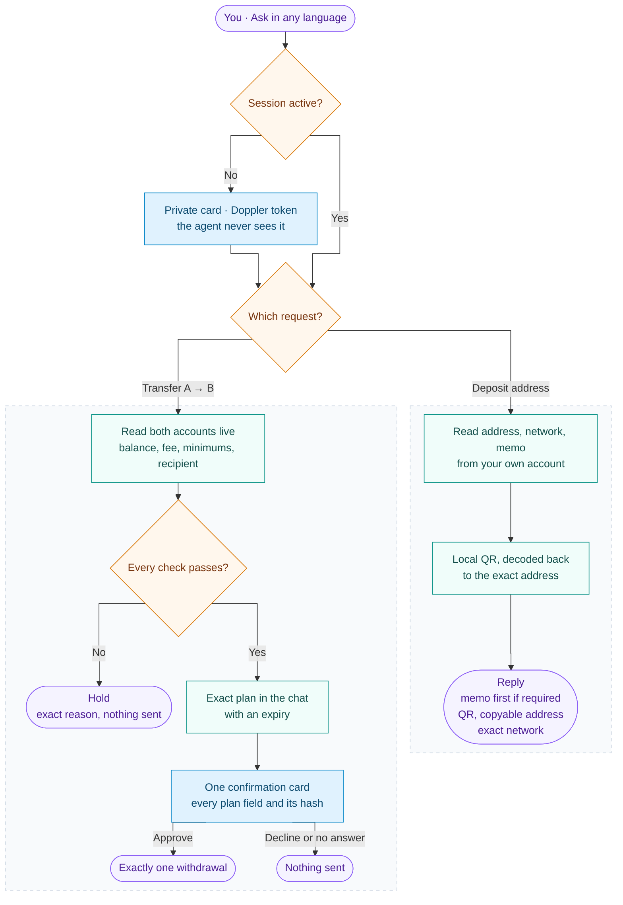

<h1 align="center">🪙 Fundkit</h1>

<p align="center"><strong>Move USDT between your own exchange accounts from an AI chat, with a human approving every send.</strong></p>

<p align="center">
  <a href="#quick-start">Quick start</a> · <a href="#what-you-ask-and-what-you-get">What you get</a> · <a href="#venues-and-hosts">Venues and hosts</a> · <a href="#safety-model">Safety model</a> · <a href="#files">Docs</a>
</p>



Fundkit is an Agent Skill ([`SKILL.md`](SKILL.md), plain Markdown) plus an optional helper,
[`bin/fundkit.mjs`](bin/fundkit.mjs). The agent talks to exchanges only through the official
MCP server [`ccxt-mcp@0.1.3`](https://github.com/ccxt/ccxt/tree/master/mcp), pinned with
`ccxt@4.5.85`, the last ccxt release with which the server's `withdraw` still passes network,
fee and memo to the exchange. It works in T3 Code, Claude Code and Codex. The helper (Node 20+,
standard library plus the pinned QR decoder `jsqr@1.4.0`) connects exchange accounts for one
session from a single Doppler config and adds two native tools: a verified deposit address with
an inline QR, and an exchange-to-exchange transfer confirmed on one bound card.

## What you ask and what you get

Write in any language; the agent replies in yours. The confirmation card's labels are fixed
English, so the agent shows the plan in your language in the chat just before the card opens.

**`Show my Binance USDT deposit address on BSC`**

- the memo first and conspicuously when the network needs one, exactly as given (leading zeros
  kept), with a note that the QR carries only the address;
- the QR inline, generated on the machine and decoded back to the exact address before it is
  shown;
- the address as copyable text, the exact network (`BNB Smart Chain (BEP20)`, Binance id `BSC`)
  and "memo: none" when there is none;
- where and when it was read. Nothing is sent.

**`Move 300 USDT from Bybit to Binance`**

- either a **hold** with the exact reason and nothing sent, never a request to look something up;
- or a **plan**: route, network, amount, fee, what leaves A and what arrives on B, the recipient
  and memo read from B's own account, and an expiry;
- then **one confirmation card** with every plan field, the plan id and its hash. Approve sends
  exactly one withdrawal. Decline, closing the card or no answer sends nothing. A plan is never
  sent twice, whatever is repeated or restarted, and anything after the credit is a separate
  request.

> [!NOTE]
> **Destination minimum: the exchange's own, or unknown. Fundkit sets none.** Some exchanges
> publish no USDT deposit minimum for a chain (Binance on every chain, MEXC, Gate on a
> multi-chain address). Then fundkit says so and recommends an amount, without checking it:
> "Destination deposit minimum unknown. Fundkit recommends depositing at least 1 USDT." That
> line is in the plan message before the confirmation card and on the card itself, and the
> address and QR lookup gives the same advice. Any positive credit after fees is planned,
> 0.5 USDT included, as long as every other read of that exchange is verified and healthy. The
> rule is the same for all eight exchanges, for transfers and for top-ups from any wallet.
> fundkit is USDT only: any other coin is refused. A minimum the exchange publishes, 0
> included, is enforced. A malformed or contradicted one holds, and a native plan with an
> unknown minimum is read again before the card and after the approval
> ([rule](references/deposit-minimum.md)).

## Quick start

Fundkit has two kinds of user. The **operator** installs it once on the machine that runs the
agent and owns the Doppler config and exchange keys. The **person asking** only chats and
approves.

### 1. Operator: install on the T3 Code server

On the server that runs T3 Code, as the user T3 runs as. It needs Node 20+ with npm, and the
`claude` or `codex` CLI that T3 uses:

```bash
git clone https://github.com/pogorelov17/fundkit.git ~/fundkit && cd ~/fundkit
node bin/fundkit.mjs install
```

This pins `ccxt-mcp`, `ccxt` and `jsqr` under `~/.local/share/fundkit/app`, links the skill
`usdt-funding` and registers one MCP server, `fundkit`, for Claude Code (user scope) and Codex
(`--no-claude`, `--no-codex` and `--no-skills` skip a step). Threads that are already running do
not load new servers, so start a new one.

### 2. Operator: one Doppler config

The config holds one account per exchange under exactly two names, and nothing else:

```text
BINANCE_APIKEY   BINANCE_SECRET
BYBIT_APIKEY     BYBIT_SECRET
GATE_APIKEY      GATE_SECRET
OKX_APIKEY       OKX_SECRET
BITGET_APIKEY    BITGET_SECRET
WHITEBIT_APIKEY  WHITEBIT_SECRET
MEXC_APIKEY      MEXC_SECRET
KUCOIN_APIKEY    KUCOIN_SECRET
```

Only the exchanges you use need entries. The same key serves an exchange as source on one route
and as destination on the reversed one; fundkit enforces the local role (a destination profile
forwards no money move, whatever the key could do). OKX, Bitget and KuCoin also need their API
passphrase, which is not stored in Doppler: it is asked for privately, once per exchange and
session, only when that exchange is needed. Users whose `ccxt-mcp` profiles are already
connected are never asked for Doppler. Data flow, roles and limits:
[scheme D](references/security.md#scheme-d-session-only-doppler-profiles-optional).

### 3. Person asking: open a new T3 chat

Ask in your own words, for example `Show my Binance USDT deposit address on BSC`. If no session
is active, T3 shows **one private card** for a read-only Doppler service token. The value goes
straight to fundkit on that machine; the agent never sees it, and the same request continues by
itself. The session lasts 8 hours or until `fundkit stop`. Depending on its permission mode, T3
may also ask once to allow the agent's `fundkit unlock` shell command.

<details>
<summary><strong>Claude Code or Codex in a terminal</strong></summary>

Install the same way. These hosts have no private secret card, so when a route needs a profile
that is not connected, the agent asks you to run this in a second terminal on that machine and
paste the token at the hidden prompt:

```bash
node ~/fundkit/bin/fundkit.mjs session
```

The same terminal then asks for an OKX, Bitget or KuCoin passphrase when one is needed. To use
one terminal instead of two, `fundkit session --passphrase okx -- claude` asks for the token and
the passphrase first and then starts Claude Code there; a passphrase needed later is entered
with `fundkit passphrase <exchange>` in another terminal. Copyable requests:
[`prompts.md`](references/prompts.md#natural-request-fundkit-installed).

</details>

<details>
<summary><strong>Your own ccxt-mcp profiles, without the helper</strong></summary>

From the repository root, in Claude Code or Codex:

```text
Read SKILL.md and help me plan a USDT transfer.
```

That explicit read is all the skill needs; start every fresh chat or host launch with it,
including the second (B) launch of scheme A. Without exchange servers the agent can explain the
flow but stops before live data. To let it read live data and execute approved writes, the
operator sets up:

1. **Server.** Install the pinned server ([install](references/ccxt-mcp.md#install)) and create
   one `config.json` per account, starting with `"dryRun": true`
   ([venue profiles](references/security.md#venue-profiles): credential fields, variable names
   and key rights for all eight exchanges).
2. **Host.** Register one server per profile and pick a launch scheme. Scheme C keeps each
   account's key in its own `chmod 600` profile file, so exchange A and exchange B are both
   connected in one session
   ([environment contract](references/security.md#environment-contract),
   [host registration](references/security.md#host-registration)).
3. **Check.** Run the [smoke check](references/security.md#smoke-check), then paste a
   [setup prompt](references/prompts.md#setup-and-diagnosis) as the first request.

Automatic skill discovery is host behavior; without `fundkit install` this repository does not
set it up ([loading the skill](references/security.md#loading-the-skill)).

</details>

## Venues and hosts

**Native tools** (fundkit server; USDT only, on TRC20, BEP20/BSC, ERC20 and TON; any other coin,
USDC included, is refused with `UNSUPPORTED_COIN` before anything is read):

| | Binance | Bybit | Gate, OKX, Bitget, WhiteBIT, MEXC, KuCoin |
| --- | --- | --- | --- |
| Deposit address with QR | ✓ | ✓ | `VENUE_NOT_NATIVE` |
| Transfer, as source | ✓ | ✓ | `VENUE_NOT_NATIVE` |
| Transfer, as destination | ✓ minimum unknown: no Fundkit minimum, advice only ([rule](references/deposit-minimum.md)) | ✓ Bybit's `depositMin`; unknown only when the field is absent | `VENUE_NOT_NATIVE` |

**Documented flows** ([`SKILL.md`](SKILL.md), all eight exchanges), used when you ask for them:

- **Wallet → exchange**, from any compatible wallet (mobile, desktop or hardware). The agent
  picks a network from live data and reads the address and memo from your own account; you
  choose USDT on that network in your wallet, check its contract, enter the address, memo and
  amount, and sign there yourself. The deposit is matched by transaction hash and expected
  credit.
- **Exchange A → exchange B, semi-automatic.** Both accounts in one session; you approve the
  plan with `APPROVE <PLAN-ID>` and `WITHDRAW <PLAN-ID>` and confirm each money move in the
  host's native form, after the operator's one-time
  [setup record](references/security.md#setup-record). Where B publishes no deposit minimum
  (Binance, MEXC, multi-chain Gate), the minimum is
  [unknown](references/deposit-minimum.md) and the plan carries the 1 USDT recommendation, not a
  check. Where B documents no deposit fee
  (KuCoin), the route holds unless you supply that value from B's deposit page for that plan
  ([per-plan human-read fact](SKILL.md#per-plan-human-read-facts)). These flows are USDT only,
  and the minimum rule in them is an agent procedure that has not been re-run as a test. Route
  by route:
  [status by destination venue](references/recipients.md#status-by-destination-venue).
- **Funding ↔ trading/margin** on one exchange.
- **Hyperliquid**: watch-only margin and position checks by public address.

**Hosts:**

| Host | Token and passphrases | Money confirmation |
| --- | --- | --- |
| T3 Code | one private secret card each (`request_secret`, file delivery) | one fundkit card per plan |
| Claude Code, Codex | hidden prompt in a private terminal (`fundkit session`) | the host's native MCP form, once the operator has [checked](references/security.md#interactive-native-form) that no hook answers it |

Known host limits: T3 cannot answer ccxt-mcp's own form, so the older `fundkit_write` path fails
closed there and native transfers use the fundkit card instead; two T3 threads cannot hold the
same profile at once (`ALIAS_IN_USE`); with a custom Claude home, register `fundkit` in project
or local settings. Full list:
[T3 Code host limits](references/security.md#t3-code-host-limits).

## Safety model

- **One human approval per send.** A native plan is bound to its exact fields by a hash and an
  expiry and runs on a single-use source profile capped at its amount. The dispatch is journaled
  with an exclusive create before the call, so a repeat, a restart or a timeout never sends
  again, and an unknown outcome is never retried. Documented flows need `APPROVE`, `WITHDRAW`
  and the host's native form for every money move.
- **Secrets stay private.** The Doppler token and the OKX, Bitget and KuCoin passphrases are
  entered only in the host's private card or a private terminal, never in the chat, argv, the
  environment, a file or a log. The session keeps them in memory and drops them when it ends.
  Each profile gets only its own exchange's two names.
- **Recipients come from your account.** Addresses and memos are read from the destination
  account itself and checked for chain and contract, never taken from text pasted into the
  chat. `get_deposit_address` is never called; the Gate and WhiteBIT reads that may create an
  address run only with the operator's provisioning consent.
- **Roles are enforced by fundkit, not by the key.** Deposit-only, source and settlement
  profiles get per-venue method allowlists and a key check before recipient reads and money
  moves. No account UID is bound: the operator's mapping of each exchange to its two Doppler
  names is trusted.
- **Exchange side.** Use minimal key permissions, an IP allowlist and a withdrawal address
  whitelist ([key permissions](references/security.md#exchange-key-permissions)).
- **Trust model.** The skill assumes a cooperative, trusted host, operator and agent; the hard
  control is the human's answer on the card or form. Host isolation was not verified
  ([trust model](references/security.md#trust-model)).

## Example requests

```text
Show my Binance USDT deposit address on BSC.
Move 15 USDT from Binance to Bybit on BSC.
What happened to transfer FK-XXXXXXXX?
Check which exchange profiles are connected and what they are allowed to do.
I want to top up Bybit with 150 USDT from my own wallet. Which network fits and what should I check before sending?
Make a plan: 300 USDT must arrive on Bybit (UTA) from OKX (trading account), keep a 100 USDT margin reserve on OKX.
Move 50 USDT from main to trade on KuCoin. Plan first.
How much free margin and which positions are on Hyperliquid for address 0x…?
The last withdrawal is stuck. Reconcile what actually happened without repeating anything.
```

More, including setup and diagnosis prompts: [`prompts.md`](references/prompts.md).

## Files

| File | Contents |
| --- | --- |
| [`SKILL.md`](SKILL.md) | agent rules and scenarios |
| [`references/deposit-minimum.md`](references/deposit-minimum.md) | the USDT destination deposit minimum on every venue: the venue's own value enforced, or unknown with a non-binding 1 USDT recommendation; holds, scope (USDT only), native tools, recheck |
| [`references/security.md`](references/security.md) | environment contract, host registration, Doppler session, the T3 Code secret card and host limits, loading the skill, smoke check, key permissions |
| [`references/recipients.md`](references/recipients.md) | native recipient reads (address, memo, landing wallet), deposit fee and minimum sources and hard limits per venue |
| [`references/exchanges.md`](references/exchanges.md) | wallets, network data, outbound withdraw table, amount steps, account modes |
| [`references/ccxt-mcp.md`](references/ccxt-mcp.md) | pins, tool schemas, approval gates, journal, limitations, verification |
| [`references/prompts.md`](references/prompts.md) | copyable prompts for setup, diagnosis, read-only checks and planning |
| [`bin/fundkit.mjs`](bin/fundkit.mjs), [`lib/`](lib/) | optional helper: `install`, `session`, `unlock`, `passphrase`, `status`, `stop` and the `fundkit` MCP server; role allowlists in [`lib/policy.mjs`](lib/policy.mjs), native flows in [`lib/broker/native.mjs`](lib/broker/native.mjs), venue reads in [`lib/venues/`](lib/venues/), QR in [`lib/qr/`](lib/qr/) |
| [`tests/`](tests/) | offline tests: mock Doppler, pseudo-terminals, a simulated T3 host, synthetic and pinned ccxt-mcp |

## Verification and limits

The automated tests run offline, with synthetic exchange responses, a mock Doppler and a host
that answers cards the way T3 Code 0.1.11 does, as read from its runtime. The pinned ccxt-mcp
also runs with no network (`unshare -rn`) behind a recorder that refuses every write. On the
operator's real T3 Code host, T3 retrieved a verified USDT BEP20 deposit address and returned
its QR for Binance and for Bybit. Live transfer attempts there stopped at preflight holds: no
confirmation card has been shown on real T3, no live send or credit has been confirmed, and no
phone scan of the QR has been done. Offline, [`tests/test_native.py`](tests/test_native.py)
covers the secret-file handoff, the verified QR, the destination minimum and the plan card with a
fake ccxt-mcp and a T3-shaped host; the runs against the pinned ccxt-mcp and the documented flows
are in [`ccxt-mcp.md`](references/ccxt-mcp.md#verification).

Not verified beyond those address reads: real accounts, modes, available amounts, fee models,
exchange responses with a real key and actual transfers. A route that settles in the fixtures
does not show that a real route is ready, and network flags and fees are visible only with a key
on most exchanges, so plans are built from live data at request time. Hard limits per venue are in
[`recipients.md`](references/recipients.md#status-by-destination-venue). The skill gives no
execution guarantees. Use it at your own risk and start with `dryRun`.

Development checks: `npm ci`, then `npm run check` (Prettier, ESLint, `node --check`),
`ruff format --check tests && ruff check tests` (ruff 0.14.5) and `npm test`.
